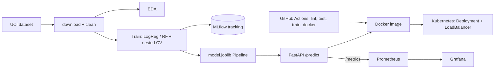

# Heart Disease Risk Prediction: MLOps Report
**Name / ID:** _<fill>_  **Repo:** _<GitHub URL>_  **Demo video:** _<link>_  **API URL / access:** _<fill>_

## 1. Introduction
Problem, dataset (UCI Cleveland, 303 rows, 13 features, binary target num>0), and objectives.

## 2. Setup & Installation
Copy the commands from README sections 1-6. Python version, OS, tool versions.

## 3. Data & EDA
- Cleaning: `?` -> NaN in `ca` (4) and `thal` (2); target binarised; duplicates dropped.
- Figures (from `reports/eda/`): class balance, histograms, correlation heatmap, categorical vs target.
- **Your findings:** class balance (~54/46), skewed `oldpeak`, strongest correlates, outliers in `chol`.

## 4. Feature Engineering & Modelling
- Pipeline: median impute + StandardScaler (numeric); mode impute + OneHot (categorical).
- Imputation inside the pipeline to avoid leakage.
- Models: Logistic Regression, Random Forest; GridSearchCV (inner 3-fold) within nested 5-fold CV.
- Results table (copy from `reports/metrics_summary.json`):

| Model | CV Acc | CV Prec | CV Recall | CV ROC-AUC | Test ROC-AUC |
|---|---|---|---|---|---|
| Logistic Regression | | | | | |
| Random Forest | | | | | |

- Selection rationale: highest nested-CV ROC-AUC; discuss recall importance for screening.

## 5. Experiment Tracking
Screenshots of MLflow experiment list, run comparison, and a run's artifacts page. Summarise params tried and best run.

## 6. Packaging & Reproducibility
`models/model.joblib` (full Pipeline), MLflow model with signature, `requirements.txt`, pinned seeds (42).

## 7. CI/CD
Workflow: lint -> pytest -> train -> docker build + smoke test. Screenshots: successful run, uploaded artifacts, and a deliberately failing run (shows the pipeline fails on errors).

## 8. Containerization
Dockerfile explanation (slim base, non-root, healthcheck). Screenshot: `docker build`, `docker run`, and a `/predict` curl response.

## 9. Kubernetes Deployment
Screenshots: `kubectl get pods,svc`, `/health` and `/predict` via the LoadBalancer/Ingress.

## 10. Monitoring & Logging
Request logs (`kubectl logs`), Prometheus targets page, Grafana dashboard screenshot.

## 11. Architecture

Render to PNG (e.g. mermaid.live) for the PDF.

## 12. Conclusion & Future Work
Limitations (small dataset), drift monitoring, model registry, automated deploy (CD) to cluster.
